# gate-run

<p align="center">
  
</p>

Rust edge tools for gated git workflows — one binary per problem, std-only,
zero dependencies.

## gate-run — the push runs inside the verdict

If your flow is "a review gate must approve before anything ships," the
gate's exit code *is* the decision — and shells lose it the moment you pipe:

```sh
./gate.sh --base main | tail -5 && git push   # tail's exit code is 0 — push ships anyway
```

`gate-run` moves the follow-up action inside the process that holds the
verdict, so the push structurally cannot run unless the gate approved:

```sh
gate-run --on-ok 'git push' -- ./gate.sh --base main
```

- Works with **any** gate command that exits 0 only when shipping is allowed
  — [turbo-flow](https://github.com/marcuspat/turbo-flow)'s rig-lite
  `gate.sh`, your own review script, a CI one-liner.
- Output streams through live; pipe gate-run itself wherever you like —
  `--on-ok` still only fires on exit 0.
- `--on-fail CMD` runs a hook (alert, cleanup) on any nonzero verdict.
- Exit code = the gate's (or the `--on-ok` command's). A gate killed by a
  signal fails closed (125); an unrunnable gate command is 127.

## strand — early-merge strand detector (read-only)

You merge a PR from the web UI while a bot or teammate is still pushing
commits to the branch — those commits are now unreachable from the main line
and invisible to every dashboard. `strand` finds them:

```sh
strand --all                  # every local branch vs the main line
strand --base develop feat-x  # one branch, custom base
```

- Classifies each branch: `MERGED` (safe to delete) · `MERGED (patch-equiv)`
  · `EARLY-MERGE RESIDUE` (stranded commits — the incident signature) ·
  `UNMERGED` (a normal working branch).
- Detection is content-based: a web-UI merge lands as a merge commit or a
  squash, neither of which preserves patch-ids, and the squash's tree only
  matches the branch's when the main line stood still since the fork. strand
  proves "the main line contains the branch up to commit P" with
  `git merge-tree` — correct for merge commits AND squashes on a moving main
  line, order-aware (a later hotfix picked into the main line does not fake
  a partial merge), and immune to non-ASCII paths and subdirectory cwds.
- Read-only: prints stranded commits oldest-first with suggested
  cherry-pick rescue commands — printed, never executed. Exit 1 when
  stranding exists, so it can gate a nightly sweep. Needs git ≥ 2.38.

## Build & test

```sh
cargo test
cargo build --release
```

No external crates. Rust 1.70+.

## License

MIT — see [LICENSE](LICENSE).
