# gate-run

<p align="center">
  
</p>

Rust edge tools for gated git workflows — one binary per problem, std-only,
zero dependencies. Docs: [adventurewave-labs.github.io/gate-run](https://adventurewave-labs.github.io/gate-run/).

## gate-run — the push runs inside the verdict

If your flow is "a review gate must approve before anything ships," the
gate's exit code *is* the decision — and shells lose it the moment you pipe:

```sh
./gate.sh --base main | tail -5 && git push   # tail's exit code is 0 — push ships anyway
```

`gate-run` moves the follow-up action inside the process that holds the
verdict, so the push structurally cannot run unless the gate approved:

```sh
gate-run --on-ok 'git push' -- ./gate.sh --base main
```

- Works with **any** gate command that exits 0 only when shipping is allowed
  — [turbo-flow](https://github.com/marcuspat/turbo-flow)'s rig-lite
  `gate.sh`, your own review script, a CI one-liner.
- Output streams through live; pipe gate-run itself wherever you like —
  `--on-ok` still only fires on exit 0.
- `--on-fail CMD` runs a hook (alert, cleanup) on any nonzero verdict.
- Exit code = the gate's (or the `--on-ok` command's). A gate killed by a
  signal fails closed (125); an unrunnable gate command is 127.

## strand — early-merge strand detector (read-only)

You merge a PR from the web UI while a bot or teammate is still pushing
commits to the branch — those commits are now unreachable from the main line
and invisible to every dashboard. `strand` finds them:

```sh
strand --all                  # every local branch vs the main line
strand --base develop feat-x  # one branch, custom base
```

- Classifies each branch: `MERGED` (safe to delete) · `MERGED (patch-equiv)`
  · `EARLY-MERGE RESIDUE` (stranded commits — the incident signature) ·
  `UNMERGED` (a normal working branch).
- For each possible partial merge, `strand` checks whether the branch commit
  is reachable from the base or the base matches its content at every path
  changed since the fork. This handles merge commits and squashes on a moving
  main line. A later hotfix cherry-picked into the base cannot by itself make
  a branch look partially merged. Patch IDs account for cherry-picked changes
  that later evolved, and an exact revert cancels a matching patch. Failed Git
  probes stop classification.
- Read-only: prints stranded commits oldest-first with suggested
  cherry-pick rescue commands — printed, never executed. Exit 1 when
  stranding exists, so it can gate a nightly sweep. Needs git ≥ 2.38.

## Install

Starting with v0.1.1, [GitHub releases](https://github.com/adventurewave-labs/gate-run/releases)
provide archives for x86-64 and ARM64 Linux (GNU libc) and macOS (Apple Silicon
and Intel). Each archive contains both `gate-run` and `strand`. Download the
archive and its matching `.sha256` file. For example, on Apple Silicon:

```sh
shasum -a 256 -c gate-run-v0.1.2-aarch64-apple-darwin.tar.gz.sha256
tar -xzf gate-run-v0.1.2-aarch64-apple-darwin.tar.gz
mkdir -p "$HOME/.local/bin"
install -m 755 gate-run strand "$HOME/.local/bin/"
```

Add `$HOME/.local/bin` to `PATH` if needed. `strand` requires Git 2.38 or newer.

To install from source (Rust 1.70+, no external crates to fetch):

```sh
cargo install --locked --git https://github.com/adventurewave-labs/gate-run
```

## Build & test

```sh
cargo test --locked
cargo build --release --locked
```

No external crates. Rust 1.70+.

## License

MIT — see [LICENSE](LICENSE).

## Source and releases

The Rust source files and integration tests are generated from
`rust-utils/utils/` in the canonical `marcuspat/turbo-rig` repository, which
also supplies the Turbo Rig kit. Send source fixes upstream. Maintainers
run `scripts/export-gate-run.sh` from canonical Turbo Rig before preparing
a release here and compare the snapshot with canonical main before tagging.
The workflow checks the four committed files against `SOURCE-SHA256` before
building. The snapshot is committed here so GitHub
builds and `cargo install --git` work without access to the canonical repo.
